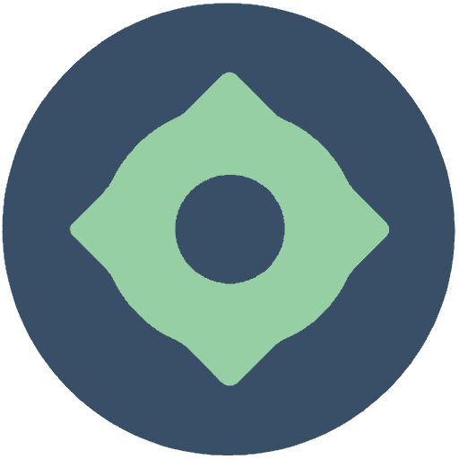
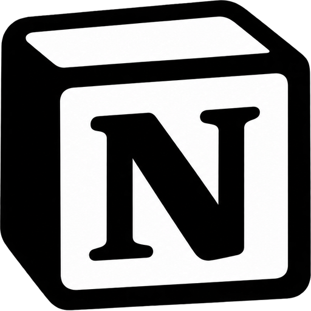

<div align="center" dir="rtl">
  
  
  # 98Router - روتر هوشمند و بهینه‌ساز مصرف توکن هوش مصنوعی

  **فورک ارتقایافته و با کارایی بالای [9Router](https://github.com/decolua/9router) همراه با پشتیبانی از GapCode/GapGPT، سرویس Notion Web AI، ویرایش تصویر با تصاویر مرجع، و استریم پیشرفته Kiro.**

  **کدنویسی بدون توقف. صرفه‌جویی ۲۰ تا ۴۰ درصدی توکن‌ها با RTK + سوییچ خودکار (Failover) به مدل‌های رایگان و ارزان.**

  **اتصال تمامی ابزارهای کدنویسی هوش مصنوعی (Claude Code، Cursor، Antigravity، Copilot، Codex، Gemini، OpenCode، Cline، OpenClaw و...) به بیش از ۴۵ ارائه‌دهنده و ۱۲۰+ مدل.**

  [](https://www.npmjs.com/package/98router)
  [](https://www.npmjs.com/package/98router)
  [](https://github.com/rm1dev/9router/blob/feat/gapcode/LICENSE)

[🚀 شروع سریع](#-شروع-سریع) • [💡 قابلیت‌ها](#-قابلیت‌های-کلیدی) • [📖 راهنمای راه‌اندازی](#-راهنمای-راه‌اندازی) • [⚡ چرا 98Router؟](#-چرا-98router-به-جای-9router) • [English](../README.md)

</div>

---

<div dir="rtl">

## ⚡ چرا 98Router به جای 9Router؟

> **98Router یک نسخه و برنچ اختصاصی بر پایه 9Router است.** اگر در انتخاب بین نسخه استاندارد 9Router و 98Router مردد هستید، بدانید که **98Router تمام قابلیت‌های 9Router اصلی را داراست به علاوه ویژگی‌های کلیدی و انحصاری زیر**:
>
> 1. **🔥 پشتیبانی کامل از اکوسیستم GapCode و GapGPT (از طریق OAuth و وب)**:
>    - ادغام بومی احراز هویت CLI با پروکسی لوپ‌بک روی پورت `1455` و فرمت `openai-responses` با هدر `originator: "codex_cli_rs"`.
>    - دسترسی مستقیم به مدل‌های قدرتمند: `gg/gpt-6-astra`، `gg/kimi-3`، `gg/gapgpt-qwen-3.6`، `gg/glm-5.3` و غیره.
>    - مانیتورینگ زنده سهمیه و مصرف لحظه‌ای از طریق اندپوینت `/codex/usage`.
>    - ارائه‌دهنده وب **GapGPT Web** با لاگین کوکی، استخراج خودکار مدل‌ها و **تولید تصویر در وب (Web Image Generation)**.
> 2. **📝 پشتیبانی از ارائه‌دهنده Notion Web AI (`notion-web`)**:
>    - اتصال مستقیم به هوش مصنوعی Notion از طریق کوکی سشن مرورگر.
>    - پشتیبانی از ادامه‌دار بودن گفتگو (Thread Continuation)، تکمیل چت و رهگیری مصرف بدون نیاز به هزینه‌های سازمانی.
> 3. **🎨 تصاویر مرجع و اندپوینت ویرایش تصویر (`/images/edits`)**:
>    - پشتیبانی از تصاویر مرجع در ارائه‌دهنده‌های تصویری (مانند ChatGPT Web، Codex، Gemini، OpenAI).
>    - پیاده‌سازی اندپوینت استاندارد `POST /images/edits` برای تغییر تصویر، Inpainting و پرامپت‌های Image-to-Image.
> 4. **🧠 ارتقای رهگیری Kiro 1.2.56+ MITM و ترنسپورت Responses**:
>    - سازگاری کامل هندلر پروکسی MITM با نسخه‌های Kiro 1.2.56+.
>    - ترنسپورت مستقیم بر بستر پروتکل OpenAI Responses.
>    - استریم مرحله‌ای توکن‌های تفکر (Incremental thinking/reasoning) و نگاشت ابزارهای CLI.
> 5. **📊 بازطراحی داشبورد و گروه‌بندی سهمیه‌ها بر اساس ارائه‌دهنده**:
>    - پنل ریسپانسیو و نوار ابزار فشرده برای مشاهده و مدیریت تمیز سهمیه‌ها، اکانت‌های چندگانه و کلیدهای مختلف.

---

## 🤔 چرا 98Router؟

**جلوگیری از هدررفت پول، توکن و محدودیت‌های ناگهانی:**

- ❌ سهمیه اشتراک‌ها در پایان ماه بدون استفاده می‌سوزد
- ❌ لیمیت شدن نرخ ارسال درخواست وسط کدنویسی کار را متوقف می‌کند
- ❌ خروجی ابزارها (git diff، grep، ls...) به شدت توکن مصرف می‌کنند
- ❌ هزینه‌های سنگین API برای هر ارائه‌دهنده ($۲۰ تا $۵۰ در ماه)
- ❌ سوییچ دستی خسته‌کننده میان ارائه‌دهنده‌های مختلف

**98Router این مشکل را حل می‌کند:**

- ✅ **فشرده‌ساز هوشمند RTK** - فشرده‌سازی خودکار خروجی ابزارها و صرفه‌جویی ۲۰ تا ۴۰ درصدی توکن‌ها در هر درخواست
- ✅ **استفاده حداکثری از اشتراک‌ها** - رهگیری سهمیه و مصرف آن تا آخرین ذره پیش از ریست ماهانه
- ✅ **سوییچ خودکار هوشمند** - انتقال از اشتراک پرداختی ← مدل ارزان ← مدل رایگان، بدون کوچکترین وقفه
- ✅ **پشتیبانی از چند اکانت** - چرخش دوره‌ای (Round-robin) بین چندین اکانت برای هر ارائه‌دهنده
- ✅ **جهانی و سازگار** - هماهنگ با Claude Code، Codex، Cursor، Cline و کلیه ابزارهای CLI

---

## 🔄 نحوه کارکرد

</div>

```
┌─────────────┐
│ ابزار CLI   │  (Claude Code, Codex, OpenClaw, Cursor, Cline...)
│ شما         │
└──────┬──────┘
       │ http://localhost:20128/v1
       ↓
┌─────────────────────────────────────────────┐
│          98Router (روتر هوشمند)             │
│  • بهینه‌ساز RTK (فشرده‌سازی خروجی ابزارها)   │
│  • ترجمه فرمت‌ها (OpenAI ↔ Claude ↔ ...)    │
│  • رهگیری زنده سهمیه‌ها                      │
│  • ریفرش خودکار توکن‌های OAuth               │
└──────┬──────────────────────────────────────┘
       │
       ├─→ [سطح ۱: اشتراکی] Claude Code، Codex، GapGPT، GitHub Copilot
       │   ↓ اتمام سهمیه
       ├─→ [سطح ۲: ارزان] GLM ($0.6/1M)، MiniMax ($0.2/1M)
       │   ↓ رسیدن به سقف بودجه
       └─→ [سطح ۳: رایگان] Kiro، OpenCode Free، Vertex ($300 اعتبار)، Notion Web

نتیجه: کدنویسی بی‌وقفه با حداقل هزینه + ۲۰ تا ۴۰ درصد صرفه‌جویی توکن با RTK
```

<div dir="rtl">

---

## ⚡ شروع سریع

**۱. نصب سراسری:**

</div>

```bash
npm install -g 98router
98router
```

<div dir="rtl">

🎉 داشبورد در آدرس `http://localhost:20128` باز می‌شود.

**۲. اتصال ارائه‌دهنده‌های رایگان یا اشتراکی:**

داشبورد → Providers → اتصال **Kiro AI** (حدود ۵۰ اعتبار رایگان در ماه: Claude 4.5 + GLM-5 + MiniMax) یا **GapGPT** یا **OpenCode Free** (بدون نیاز به لاگین) → تمام!

**۳. تنظیم ابزار CLI:**

</div>

```
تنظیمات در Claude Code / Codex / OpenClaw / Cursor / Cline:
  Endpoint: http://localhost:20128/v1
  API Key: [کپی از داشبورد]
  Model: kr/claude-sonnet-4.5
```

<div dir="rtl">

**اجرا از روی سورس کد (همین ریپازیتوری):**

</div>

```bash
cp .env.example .env
npm install
PORT=20128 NEXT_PUBLIC_BASE_URL=http://localhost:20128 npm run dev
```

<div dir="rtl">

حالت پروداکشن:

</div>

```bash
npm run build
PORT=20128 HOSTNAME=0.0.0.0 NEXT_PUBLIC_BASE_URL=http://localhost:20128 npm run start
```

<div dir="rtl">

آدرس‌های پیش‌فرض:
- داشبورد: `http://localhost:20128/dashboard`
- رابط سازگار با OpenAI: `http://localhost:20128/v1`

---

## 🛠️ ابزارهای CLI پشتیبانی‌شده

98Router با تمامی ابزارهای برجسته کدنویسی هماهنگ است:

</div>

<div align="center">
  <table>
    <tr>
      <td align="center" width="120">
        <br/>
        <b>Claude-Code</b>
      </td>
      <td align="center" width="120">
        <br/>
        <b>OpenClaw</b>
      </td>
      <td align="center" width="120">
        <br/>
        <b>Codex</b>
      </td>
      <td align="center" width="120">
        <br/>
        <b>OpenCode</b>
      </td>
      <td align="center" width="120">
        <br/>
        <b>Cursor</b>
      </td>
      <td align="center" width="120">
        <br/>
        <b>Antigravity</b>
      </td>
    </tr>
    <tr>
      <td align="center" width="120">
        <br/>
        <b>Cline</b>
      </td>
      <td align="center" width="120">
        <br/>
        <b>Continue</b>
      </td>
      <td align="center" width="120">
        <br/>
        <b>Droid</b>
      </td>
      <td align="center" width="120">
        <br/>
        <b>Roo</b>
      </td>
      <td align="center" width="120">
        <br/>
        <b>Copilot</b>
      </td>
      <td align="center" width="120">
        <br/>
        <b>Kilo Code</b>
      </td>
    </tr>
  </table>
</div>

<div dir="rtl">

---

## 🌐 ارائه‌دهندگان پشتیبانی‌شده

### 🔐 ارائه‌دهندگان OAuth

</div>

<div align="center">
  <table>
    <tr>
      <td align="center" width="120">
        <br/>
        <b>GapGPT</b>
      </td>
      <td align="center" width="120">
        <br/>
        <b>Claude-Code</b>
      </td>
      <td align="center" width="120">
        <br/>
        <b>Antigravity</b>
      </td>
      <td align="center" width="120">
        <br/>
        <b>Codex</b>
      </td>
      <td align="center" width="120">
        <br/>
        <b>GitHub</b>
      </td>
      <td align="center" width="120">
        <br/>
        <b>Cursor</b>
      </td>
    </tr>
  </table>
</div>

<div dir="rtl">

### 🌐 ارائه‌دهندگان سشن وب (اختصاصی 98Router)

</div>

<div align="center">
  <table>
    <tr>
      <td align="center" width="150">
        <br/>
        <b>GapGPT Web</b><br/>
        <sub>ورود با کوکی • دریافت مدل‌ها<br/>چت و تولید تصویر</sub>
      </td>
      <td align="center" width="150">
        <br/>
        <b>Notion Web</b><br/>
        <sub>ورود با سشن • ادامه گفتگوها<br/>رهگیری توکن</sub>
      </td>
    </tr>
  </table>
</div>

<div dir="rtl">

### 🆓 ارائه‌دهندگان رایگان

</div>

<div align="center">
  <table>
    <tr>
      <td align="center" width="150">
        <br/>
        <b>Kiro AI</b><br/>
        <sub>Claude 4.5 + GLM-5 + MiniMax<br/>۵۰ اعتبار رایگان در ماه</sub>
      </td>
      <td align="center" width="150">
        <br/>
        <b>OpenCode Free</b><br/>
        <sub>بدون نیاز به احراز هویت • دریافت خودکار مدل‌ها<br/>رایگان</sub>
      </td>
      <td align="center" width="150">
        <br/>
        <b>Vertex AI</b><br/>
        <sub>Gemini 3 Pro + GLM-5 + DeepSeek<br/>۳۰۰ دلار اعتبار اولیه گوگل کلاود</sub>
      </td>
    </tr>
  </table>
</div>

<div dir="rtl">

### 🔑 ارائه‌دهندگان با کلید API (بیش از ۴۰ مورد)
شامل OpenAI، Anthropic، Gemini، DeepSeek، Groq، xAI، Mistral، Perplexity، Together AI، Fireworks، Cerebras، Cohere، NVIDIA، SiliconFlow، OpenRouter، GLM، Kimi، MiniMax و اندپوینت‌های سفارشی.

---

## 💡 قابلیت‌های کلیدی

| قابلیت | عملکرد | اهمیت |
| --- | --- | --- |
| 🚀 **بهینه‌ساز توکن RTK** | فشرده‌سازی خروجی ابزارها (`git diff`، `grep`، `ls` و...) قبل از ارسال به مدل | **صرفه‌جویی ۲۰ تا ۴۰ درصدی توکن ورودی** |
| ⚡ **GapCode / GapGPT (OAuth و وب)** | ترنسپورت بومی Responses، پروکسی پورت ۱۴۵۵، رهگیری `/codex/usage`، تولید تصویر در وب | دسترسی به `gpt-6-astra`، `kimi-3` و مدل‌های کدنویسی |
| 📝 **سرویس Notion Web AI** | احراز هویت سشن وب، پشتیبانی از ادامه‌دار بودن گفتگو و مانیتورینگ توکن | استفاده رایگان از دستیار هوش مصنوعی نوشن |
| 🎨 **ویرایش و تصاویر مرجع** | پشتیبانی از تصویر مرجع و مسیر `POST /images/edits` در ChatGPT Web، Codex و Gemini | دسترسی به ساخت انواع ویرایش‌ها و تنوع‌های تصویری |
| 🪨 **حالت Caveman** | تزریق پرامپت فشرده‌سازی پاسخ → پاسخی فنی، دقیق و بسیار مختصر | **صرفه‌جویی تا ۶۵٪ در توکن خروجی** |
| 🐴 **حالت Ponytail** | تزریق پرامپت برنامه‌نویس ارشد تنبل (YAGNI-first) → کدنویسی حداقلی و موثر | کد تمیزتر، دیف‌های کوتاه‌تر، مصرف توکن کمتر |
| 🎯 **سوییچ خودکار ۳ لایه** | مسیریابی خودکار: اشتراکی ← ارزان ← رایگان | بدون وقفه در حین کار |
| 📊 **رهگیری زنده سهمیه‌ها** | نمایش زنده توکن مصرفی + زمان باقیمانده تا ریست سهمیه | حداکثر استفاده از ارزش اشتراک‌ها |
| 🔄 **ترجمه فرمت‌ها** | ترجمه میان OpenAI ↔ Claude ↔ Gemini ↔ Cursor ↔ Kiro ↔ Vertex ↔ Responses | هماهنگ با همه ابزارها |
| 👥 **چند اکانت همزمان** | تعریف چند حساب کاربری برای هر سرویس‌دهنده | توزیع بار و پشتیبان همیشگی |
| 🔄 **ریفرش خودکار توکن** | تمدید خودکار توکن‌های منقضی‌شده OAuth | بی‌نیازی از ورود مکرر |

برای لغو موقت توکن‌سیورها در یک درخواست می‌توانید هدر `X-98Router-Token-Saver: off` (یا `X-9Router-Token-Saver: off`) را ارسال کنید.

---

## 💰 قیمت‌گذاری و شفافیت هزینه‌ها

| سطح | سرویس‌دهنده | هزینه | زمان ریست سهمیه | مناسب برای |
| --- | --- | --- | --- | --- |
| **🚀 ذخیره توکن** | **RTK داخلی** | **رایگان** | همیشگی | **صرفه‌جویی ۲۰-۴۰٪ در هر درخواست** |
| **💳 اشتراکی** | GapGPT / GapCode (OAuth) | بر اساس اشتراک | زنده `/codex/usage` | GPT-6 Astra، Kimi 3 و اکوسیستم کادکس |
| | Claude Code (Pro/Max) | $20-200/ماه | ۵ ساعته + هفتگی | دارندگان اشتراک |
| | Codex (Plus/Pro) | $20-200/ماه | ۵ ساعته + هفتگی | کاربران OpenAI |
| | GitHub Copilot | $10-19/ماه | ماهانه | کاربران گیت‌هاب |
| | Cursor IDE | $20/ماه | ماهانه | کاربران کرسر |
| **💰 اقتصادی** | GLM-5.1 / GLM-4.7 | $0.6/1M توکن | روزانه ۱۰ صبح | پشتیبان اقتصادی |
| | MiniMax M2.7 | $0.2/1M توکن | چرخش ۵ ساعته | ارزان‌ترین مدل برای کانکست‌های طولانی |
| **🆓 رایگان / وب** | Notion Web AI | $0 | سشن وب | چت و یادداشت‌برداری بی‌هزینه |
| | Kiro AI | $0 | ۵۰ کردیت در ماه | کلود ۴.۵، GLM-5 و مینی‌مکس رایگان |
| | OpenCode Free | $0 | متغیر | دسترسی بدون لاگین |
| | Vertex AI | $300 اعتبار | حساب جدید GCP | جیمینای ۳ پرو و دیپ‌سیک |

### 📊 واقعیت صورتحساب و نمایش هزینه‌ها در داشبورد:
- **نرم‌افزار 98Router کاملاً متن‌باز و برای همیشه رایگان است.**
- هزینه‌هایی که در داشبورد مشاهده می‌کنید **صرفاً جهت اطلاع از میزان ارزش توکن‌های مصرفی و مقایسه صرفه‌جویی** است و به هیچ عنوان قبض یا صورتحساب واقعی نیست.
- پرداخت‌های پولی مستقیماً بین شما و ارائه‌دهندگان اصلی (مثل آنتروپیک، اوپن‌ای‌آی یا گپ‌جی‌پی‌تی) انجام می‌شود و 98Router هیچ اطلاعات مالی یا پرداختی دریافت نمی‌کند.

---

## 📖 راهنمای راه‌اندازی

<details>
<summary><b>🔐 سرویس‌های اشتراکی</b></summary>

### GapCode / GapGPT (Plus/Pro)

</div>

```bash
داشبورد → Providers → اتصال GapGPT
→ ورود با OAuth CLI (پروکسی خودکار روی پورت 1455)
→ رهگیری زنده سهمیه از طریق /codex/usage

مدل‌ها:
  gg/gpt-6-astra
  gg/gpt-6.1-sol
  gg/kimi-3
  gg/gapgpt-qwen-3.6
  gg/glm-5.3
  gg/deepseek-v4-flash
```

<div dir="rtl">

### Claude Code (Pro/Max)

</div>

```bash
داشبورد → Providers → اتصال Claude Code
→ لاگین OAuth → ریفرش خودکار توکن
→ رهگیری سهمیه ۵ ساعته و هفتگی

مدل‌ها:
  cc/claude-opus-4-7
  cc/claude-opus-4-6
  cc/claude-sonnet-4-6
```

<div dir="rtl">

### OpenAI Codex (Plus/Pro)

</div>

```bash
داشبورد → Providers → اتصال Codex
→ لاگین OAuth (پورت 1455)
→ ریست ۵ ساعته و هفتگی

مدل‌ها:
  cx/gpt-5.5
  cx/gpt-5.4
  cx/gpt-5.3-codex
```

<div dir="rtl">

</details>

<details>
<summary><b>🆓 سرویس‌های وب و رایگان</b></summary>

### Notion Web AI (رایگان با سشن وب)

</div>

```bash
داشبورد → Providers → اتصال Notion Web
→ ورود به وب / کپی کوکی سشن نوشن
→ چت چندمرحله‌ای و ادامه زنجیره گفتگو

مدل:
  notion-web/notion-ai
```

<div dir="rtl">

### Kiro AI (سرویس رایگان Claude 4.5 + GLM-5 + MiniMax)

</div>

```bash
داشبورد → Providers → اتصال Kiro
→ ورود با AWS Builder ID یا Google یا GitHub
→ استفاده رایگان از سهمیه ماهانه

مدل‌ها:
  kr/claude-sonnet-4.5
  kr/claude-haiku-4.5
  kr/glm-5
  kr/MiniMax-M2.5
  kr/qwen3-coder-next
  kr/deepseek-3.2
```

<div dir="rtl">

</details>

---

## 🔧 اتصال به ابزارهای برنامه‌نویسی

### در نرم‌افزار Cursor IDE:
- مسیر: `Settings → Models → Advanced`
- فیلد `OpenAI API Base URL`: مقدار `http://localhost:20128/v1`
- فیلد `OpenAI API Key`: کلید کپی شده از داشبورد 98Router
- مدل انتخابی: `gg/gpt-6-astra` یا `cc/claude-opus-4-7` یا کمبوهای سفارشی

### در Claude Code:
فایل تنظیمات `~/.claude/config.json`:

</div>

```json
{
  "anthropic_api_base": "http://localhost:20128/v1",
  "anthropic_api_key": "your-98router-api-key"
}
```

<div dir="rtl">

### در Codex CLI:

</div>

```bash
export OPENAI_BASE_URL="http://localhost:20128"
export OPENAI_API_KEY="your-98router-api-key"

codex "prompt shoma"
```

<div dir="rtl">

### در OpenClaw:
در فایل `~/.openclaw/openclaw.json`:

</div>

```json
{
  "agents": {
    "defaults": {
      "model": {
        "primary": "98router/kr/claude-sonnet-4.5"
      }
    }
  },
  "models": {
    "providers": {
      "98router": {
        "baseUrl": "http://127.0.0.1:20128/v1",
        "apiKey": "sk_98router",
        "api": "openai-completions",
        "models": [
          {
            "id": "kr/claude-sonnet-4.5",
            "name": "Claude Sonnet 4.5 (Kiro Free)"
          }
        ]
      }
    }
  }
}
```

<div dir="rtl">

---

## 🚀 استقرار با داکر (Docker)

</div>

```bash
# بیلد و اجرا از سورس
git clone https://github.com/rm1dev/9router.git 98router
cd 98router
docker build -t 98router .
docker run -d --name 98router -p 20128:20128 \
  -v "$HOME/.98router:/app/data" -e DATA_DIR=/app/data 98router
```

<div dir="rtl">

---

## 📝 مرجع فراخوانی API

### درخواست چت (Chat Completions):

</div>

```bash
POST http://localhost:20128/v1/chat/completions
Authorization: Bearer your-api-key
Content-Type: application/json

{
  "model": "gg/gpt-6-astra",
  "messages": [
    {"role": "user", "content": "تابعی بنویس که..."}
  ],
  "stream": true
}
```

<div dir="rtl">

### ویرایش تصاویر با تصویر مرجع (Images Edits):

</div>

```bash
POST http://localhost:20128/v1/images/edits
Authorization: Bearer your-api-key
Content-Type: multipart/form-data
```

<div dir="rtl">

---

## 🙏 تقدیر و تشکر

پروژه **98Router** بر پایه تلاش‌های توسعه‌دهندگان بزرگ بنا شده است:
- **[9Router](https://github.com/decolua/9router)** — پروژه اصلی و پایه‌ای روتر هوش مصنوعی که 98Router از آن منشعب و ارتقا داده شده است.
- **[CLIProxyAPI](https://github.com/router-for-me/CLIProxyAPI)** — پیاده‌سازی اولیه Go که الهام‌بخش نسخه جاوااسکریپت بود.
- **[RTK](https://github.com/rtk-ai/rtk)** — تکنولوژی بهینه‌سازی و فشرده‌سازی پرامپت‌ها در Rust.
- **[Caveman](https://github.com/JuliusBrussee/caveman)** — پرامپت فشرده‌سازی پاسخ‌ها جهت صرفه‌جویی ۶۵ درصدی در توکن‌های خروجی.
- **[Ponytail](https://github.com/DietrichGebert/ponytail)** — مهارت برنامه‌نویس ارشد تنبل جهت ارائه کوتاه‌ترین و مؤثرترین پاسخ‌های کدنویسی.

---

## 📄 مجوز

مجوز متن‌باز MIT - برای جزئیات به فایل [LICENSE](../LICENSE) مراجعه کنید.

</div>
